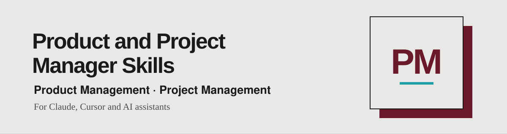

<div align="center">

[English](README.md) · [Português](README.pt.md) · **🌐 Español**



*Skills para product y project managers, listas para usar con tu asistente de IA.*

<a href="https://www.linkedin.com/in/matheusmello00/"></a>
<a href="mailto:m.mello00@outlook.com"></a>
<a href="https://wa.me/351920102358"></a>


</div>

---

## 🧭 Empieza por el trabajo que tienes entre manos

| Etapa | Trae esto | Usa esta skill | Pide esto |
|---|---|---|---|
| Discovery y Research | Un montón de feedback en bruto (CSV, exportación de NPS, comentarios pegados) | `feedback-analyzer` | Clasifica este feedback por tema, sentimiento y urgencia, con citas literales y los tres patrones principales. |
| Discovery y Research | Un tema de investigación o una hipótesis | `user-interview-prep` | Prepara el brief de investigación: hipótesis, un guion de entrevista de 30 minutos con preguntas no inductivas y qué observar. |
| Documentation | Una idea de producto, notas o la transcripción de un workshop | `create-prd` | Escribe un PRD de 1 a 2 páginas, con exclusiones reales, métricas medibles y una tabla de requisitos con IDs estables. |
| Backlog | El PRD (o cualquier documento grande, notas, una hoja de cálculo) | `backlog-creator` | Arma el backlog: épicas e historias (As a / I want / So that), criterios Given / When / Then y escenarios de prueba en Gherkin, todos trazados a los requisitos. |
| Backlog | El backlog que acabas de generar | `qa-check` | Valida los criterios de aceptación y los escenarios de prueba, comprueba que la descripción de cada historia tenga criterios, señala lo que no es testeable o no tiene escenario y propón los criterios y escenarios que faltan. |
| Desarrollo | Commits, tickets o notas en bruto de una release | `release-notes` | Escribe release notes orientadas al usuario, en tono B2B, B2C o interno. |

Las skills se pasan el trabajo unas a otras mediante archivos, no mediante tu memoria:

`feedback-analyzer` + `user-interview-prep` → `create-prd` → `backlog-creator` → `qa-check` → desarrollo → `release-notes`

`create-prd` escribe `prd-<nombre>.md` con una tabla de requisitos `FR-xx / NFR-xx`. `backlog-creator` importa esa tabla como inventario y escribe `<proyecto>-backlog.md`. `qa-check` lee ese backlog y devuelve un veredicto por historia, con hallazgos y propuestas de criterios y escenarios que tú aplicas y vuelves a comprobar.

El asistente lee lo que le das, hace como máximo un lote de preguntas sobre lo que bloquea el trabajo y declara sus supuestos. Nunca inventa cifras, usuarios, criterios ni cambios que no estén en tu material, y registra las lagunas como preguntas abiertas. Todo lo que propone va marcado como propuesto. Las skills solo leen tus fuentes y producen un único entregable en Markdown. La publicación en un tracker solo ocurre con aprobación explícita.

## 🧱 Cómo se construye cada skill (estándar Agent Skills)

Todas las skills siguen la [especificación abierta Agent Skills](https://agentskills.io/specification), así que funcionan en cualquier asistente compatible.

```
nombre-de-la-skill/
├── SKILL.md          # Obligatorio: frontmatter + instrucciones (menos de 500 líneas)
├── references/       # Opcional: detalle cargado solo cuando hace falta, un nivel de profundidad
├── scripts/          # Opcional: código autocontenido, con --help y errores claros
├── assets/           # Opcional: plantillas y recursos estáticos
└── evals/            # Extensión nuestra: queries de descubrimiento y escenarios de calidad
```

## 📦 Instalación

### Plugin de Claude Code

Ejecuta estos comandos dentro de Claude Code:

```text
/plugin marketplace add matheusmello00/Product-and-Project-Manager-Skills
/plugin install product-project-manager-skills@product-project-manager-skills
```

Luego invoca una skill por el nombre del plugin:

```text
/product-project-manager-skills:backlog-creator
Arma el backlog a partir de prd-bookswap.md.
```

El plugin contiene las 6 skills. No necesita API key ni servicio externo para leer las instrucciones; tu asistente aporta el modelo y, si quieres publicar, el conector del tracker.

### Codex o Cursor

Clona el repositorio y copia una skill a tu directorio personal de skills:

```bash
git clone https://github.com/matheusmello00/Product-and-Project-Manager-Skills.git
mkdir -p ~/.agents/skills
cp -R Product-and-Project-Manager-Skills/backlog-creator ~/.agents/skills/
```

Para instalar las 6, cambia el último comando por:

```bash
for s in feedback-analyzer user-interview-prep create-prd backlog-creator qa-check release-notes; do
  cp -R Product-and-Project-Manager-Skills/$s ~/.agents/skills/
done
```

Revisa si ya existen carpetas con el mismo nombre antes de copiar; copiar puede sobrescribir archivos. Para uso en equipo, copia en `.agents/skills/` dentro de tu proyecto. En Codex, invoca `$backlog-creator`; en Cursor, usa `/backlog-creator` o describe la tarea para que el asistente elija la skill.

> `qa-check` usa el script de verificación de `backlog-creator`. Instala las dos lado a lado para que la comprobación automática funcione; si no, aplica la lista de comprobación manual.

### Claude Code sin el plugin

Tras clonar, usa `~/.claude/skills/` para skills personales o `.claude/skills/` para skills de proyecto:

```bash
mkdir -p ~/.claude/skills
cp -R Product-and-Project-Manager-Skills/backlog-creator ~/.claude/skills/
```

Para instalar las 6, usa el bucle anterior cambiando `~/.agents/skills/` por `~/.claude/skills/`. Invoca `/backlog-creator`. Elige el plugin o el método de copia, no ambos, para evitar instalaciones duplicadas.

### Otros asistentes, incluido ChatGPT

Abre el `SKILL.md` correspondiente y entrégaselo junto con tu trabajo. Incluye los archivos de `references/` de esa skill (y `scripts/` si el asistente puede ejecutar Python) para tener todo el material de apoyo. El descubrimiento automático depende del asistente; clonar este repositorio no instala las skills en todos los productos.

## 👤 Autor

Creado por [Matheus Mello](https://github.com/matheusmello00) — Senior Product Manager & Agile Coach.
