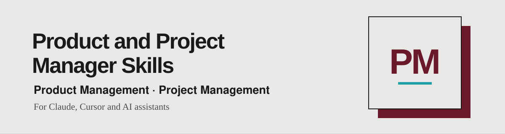

<div align="center">

**🌐 English** · [Português](README.pt.md) · [Español](README.es.md)



*Skills for product and project managers, ready to use with your AI assistant.*

<a href="https://www.linkedin.com/in/matheusmello00/"></a>
<a href="mailto:m.mello00@outlook.com"></a>
<a href="https://wa.me/351920102358"></a>


</div>

---

## 🧭 Skills

🚧 **Under Construction**

## 📦 Install

### Claude Code plugin

Run these commands inside Claude Code:

```text
/plugin marketplace add matheusmello00/Product-and-Project-Manager-Skills
```

Then install the plugin listed by the marketplace and invoke its skills by plugin name.

### Codex or Cursor

Clone the repository, then copy the skills into your personal skills directory:

```bash
git clone https://github.com/matheusmello00/Product-and-Project-Manager-Skills.git
mkdir -p ~/.agents/skills
cp -R Product-and-Project-Manager-Skills/skills/* ~/.agents/skills/
```

Check for existing folders with the same names before copying; copying can overwrite files. For team use, copy into `.agents/skills/` in your project instead.

### Claude Code without the plugin

After cloning, use `~/.claude/skills/` for personal skills or `.claude/skills/` for project skills:

```bash
mkdir -p ~/.claude/skills
cp -R Product-and-Project-Manager-Skills/skills/* ~/.claude/skills/
```

Choose either the plugin or the copy method to avoid duplicate installations.

### Other assistants, including ChatGPT

Open the relevant `SKILL.md` and provide it with your work. Automatic discovery depends on the assistant; cloning this repository does not install the skills into every product.

## 👤 Author

Built by [Matheus Mello](https://github.com/matheusmello00) — Senior Product Manager & Agile Coach.
