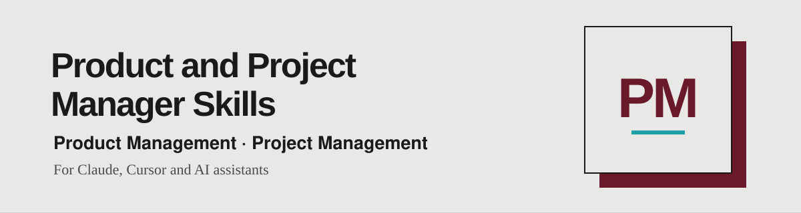

<div align="center">

[English](README.md) · **🌐 Português** · [Español](README.es.md)



*Skills para product e project managers, prontas para usar com o seu assistente de IA.*

<a href="https://www.linkedin.com/in/matheusmello00/"></a>
<a href="mailto:m.mello00@outlook.com"></a>
<a href="https://wa.me/351920102358"></a>


</div>

---

## 🧭 Comece pelo trabalho que você tem em mãos

| Etapa | Traga isto | Use esta skill | Peça isto |
|---|---|---|---|
| Discovery e Research | Um monte de feedback bruto (CSV, exportação de NPS, comentários colados) | `feedback-analyzer` | Classifique este feedback por tema, sentimento e urgência, com citações literais e os três principais padrões. |
| Discovery e Research | Um tema de pesquisa ou uma hipótese | `user-interview-prep` | Prepare o brief de pesquisa: hipóteses, um roteiro de entrevista de 30 minutos com perguntas não indutivas e o que observar. |
| Documentation | Uma ideia de produto, notas ou a transcrição de um workshop | `create-prd` | Escreva um PRD de 1 a 2 páginas, com exclusões reais, métricas mensuráveis e uma tabela de requisitos com IDs estáveis. |
| Backlog | O PRD (ou qualquer documento grande, notas, uma planilha) | `backlog-creator` | Monte o backlog: épicos e histórias (As a / I want / So that), critérios Given / When / Then e cenários de teste em Gherkin, todos rastreados aos requisitos. |
| Backlog | O backlog que você acabou de gerar | `qa-check` | Valide os critérios de aceite e os cenários de teste, confira se a descrição de cada história tem critério, aponte o que não é testável ou não tem cenário e proponha os critérios e cenários que faltam. |
| Desenvolvimento | Commits, tickets ou notas brutas de uma release | `release-notes` | Escreva release notes voltadas ao usuário, em tom B2B, B2C ou interno. |

As skills passam o trabalho umas para as outras por arquivos, não pela sua memória:

`feedback-analyzer` + `user-interview-prep` → `create-prd` → `backlog-creator` → `qa-check` → desenvolvimento → `release-notes`

A `create-prd` grava `prd-<nome>.md` com uma tabela de requisitos `FR-xx / NFR-xx`. A `backlog-creator` importa essa tabela como inventário e grava `<projeto>-backlog.md`. A `qa-check` lê esse backlog e devolve um veredito por história, com achados e propostas de critérios e cenários que você aplica e reverifica.

O assistente lê o que você fornece, faz no máximo um lote de perguntas sobre o que bloqueia o trabalho e declara as premissas. Nunca inventa números, usuários, critérios ou mudanças que não estejam no seu material, e registra as lacunas como perguntas em aberto. Tudo o que ele propõe vem marcado como proposto. As skills só leem as suas fontes e produzem um único entregável em Markdown. A publicação em tracker só acontece com aprovação explícita.

## 🧱 Como cada skill é construída (padrão Agent Skills)

Todas as skills seguem a [especificação aberta Agent Skills](https://agentskills.io/specification), então funcionam em qualquer assistente compatível.

```
nome-da-skill/
├── SKILL.md          # Obrigatório: frontmatter + instruções (menos de 500 linhas)
├── references/       # Opcional: detalhe carregado só quando necessário, um nível de profundidade
├── scripts/          # Opcional: código autocontido, com --help e erros claros
├── assets/           # Opcional: modelos e recursos estáticos
└── evals/            # Extensão nossa: queries de descoberta e cenários de qualidade
```

## 📦 Instalação

### Plugin do Claude Code

Execute estes comandos dentro do Claude Code:

```text
/plugin marketplace add matheusmello00/Product-and-Project-Manager-Skills
```

Depois instale o plugin listado pelo marketplace e invoque as skills pelo nome do plugin.

### Codex ou Cursor

Clone o repositório e copie as skills para o seu diretório pessoal de skills:

```bash
git clone https://github.com/matheusmello00/Product-and-Project-Manager-Skills.git
mkdir -p ~/.agents/skills
cp -R Product-and-Project-Manager-Skills/skills/* ~/.agents/skills/
```

Verifique se já existem pastas com o mesmo nome antes de copiar; copiar pode sobrescrever arquivos. Para uso em equipe, copie para `.agents/skills/` dentro do projeto.

### Claude Code sem o plugin

Depois de clonar, use `~/.claude/skills/` para skills pessoais ou `.claude/skills/` para skills de projeto:

```bash
mkdir -p ~/.claude/skills
cp -R Product-and-Project-Manager-Skills/skills/* ~/.claude/skills/
```

Escolha o plugin ou o método de cópia, não ambos, para evitar instalações duplicadas.

### Outros assistentes, incluindo o ChatGPT

Abra o `SKILL.md` correspondente e forneça-o junto com o seu trabalho. A descoberta automática depende do assistente; clonar este repositório não instala as skills em todos os produtos.

## 👤 Autor

Criado por [Matheus Mello](https://github.com/matheusmello00) — Senior Product Manager & Agile Coach.
